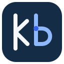

<div align="center">
  
  <h1>KB — Knowledge Base</h1>
  <p><strong>A local Knowledge Base for humans and AI agents.</strong></p>
  <p>Readable Markdown. A revision-aware CLI. A shared MCP interface.</p>
</div>

<p align="center">
  <a href="https://github.com/matheus3301/kb/actions/workflows/ci.yml"></a>
  <a href="https://github.com/matheus3301/kb/blob/main/go.mod"></a>
  <a href="LICENSE"></a>
  <a href="#project-status"></a>
</p>

`kb` lets you search, read, and update a Knowledge Base stored as
[OKF](https://github.com/GoogleCloudPlatform/open-knowledge-format) Markdown.
Use any editor to read the files. Use the CLI or MCP server to make changes
with revision checks, previews, and recoverable transactions. Optional PARA
folders keep projects, areas, resources, and archives easy to navigate.

## Getting started

Install on macOS or Linux with Homebrew, then initialize a new directory:

```sh
brew install matheus3301/tap/kb
export KB_ROOT="$PWD/example-kb"
kb init --para
```

Create a note and find it:

```sh
kb create --input - <<'JSON'
{
  "path": "03_Resources/decisions.md",
  "type": "Reference",
  "title": "Project decisions",
  "body": "# Project decisions\n\nSearch existing notes before adding new ones.\n",
  "summary": "Record the Knowledge Base workflow",
  "actor": "process:quickstart",
  "idempotency_key": "quickstart/create-decisions"
}
JSON

kb search "project decisions" --limit 5
kb read 03_Resources/decisions.md
kb context "search existing notes" --max-tokens 1000
```

Data commands return JSON by default. `KB_ROOT` selects the Knowledge Base;
all note paths are relative to it. Follow the [quickstart](docs/quickstart.md)
for editing and coordinated changes, or use [other installation methods](docs/installation.md).

## At a glance

- **Search and read:** lexical ranking, filters, sections, and bounded excerpts
  with source paths, revisions, and line references.
- **Write:** create, patch, move, and archive notes; preview changes and reconcile
  revision conflicts before replacing content.
- **Coordinate:** apply multi-note plans with idempotent retries and an explicit
  recovery journal.
- **Maintain:** inspect links, validate format/health, update managed navigation,
  and export validated snapshots.
- **Connect:** use the same Knowledge Base through a CLI, stdio MCP, or the
  optional agent skill. The binary needs no model, Node, Git, or network at runtime.

## Agent skill

Install the [knowledge-base skill](skills/knowledge-base/SKILL.md) from the
agent's workdir using [Skills](https://skills.sh):

```sh
npx skills add matheus3301/kb --skill knowledge-base
```

The skill teaches agents when to consult the Knowledge Base, how to record
reusable learning, and how to handle revisions, retries, and recovery. Its
references travel with the installed skill. Configure `KB_ROOT` or an associated
MCP server and add a deliberate workdir instruction to use it. Installation
alone does not guarantee consultation on every question.

See [setup and upgrading the renamed skill](docs/agent-setup.md). Earlier
releases used the installation name `knowledge-memory`.

## MCP

Register a stdio server in your MCP client. Start with read-only access:

```json
{
  "mcpServers": {
    "kb": {
      "command": "kb",
      "args": ["--root", "./example-kb", "mcp", "--read-only"]
    }
  }
}
```

Use an absolute root if the client cannot set the intended working directory.
[Agent setup](docs/agent-setup.md) explains write-enabled access and which
operations are exposed. Binary installation, skill installation, and MCP
registration are separate actions.

## Command map

```text
kb
├── init --para                    Create a Knowledge Base and optional PARA folders
├── status / validate              Inspect scope, format, and structural health
├── list / search                  Discover notes with filters and pagination
├── read / context / links         Read sources, collect excerpts, and inspect references
├── create / patch                 Add or revise a note
├── move / archive                 Relocate notes and update resolved references
├── apply                          Preview or execute a coordinated plan
├── maintain / index rebuild       Maintain navigation or rebuild derived search state
├── recover / export               Recover a pending transaction or export a snapshot
└── mcp / version                  Serve MCP or inspect the installed build
```

Use `kb COMMAND --help` for installed flags. The [CLI guide](docs/cli.md)
contains command syntax, JSON requests, errors, and operating limits.

## Project status

**Experimental.** Use v0.1.3 or later for the documented metadata-preservation
fixes. [Release QA](docs/qa/verification-footer-regression.md) records the findings
and source verification; [release notes](https://github.com/matheus3301/kb/releases)
include installed-package results. Performance remains below the original
[targets](docs/performance.md). Advisory locks cannot isolate arbitrary external
editors, and health checks do not establish semantic truth.

## Documentation

- [Quickstart](docs/quickstart.md), [CLI guide](docs/cli.md), and [installation](docs/installation.md).
- [Agent setup](docs/agent-setup.md), [skill](skills/knowledge-base/SKILL.md), and [llms.txt](llms.txt).
- [Architecture](docs/project-overview.md), [specification](docs/spec.md), and [interface contract](docs/interfaces.md).
- [Quality gates](docs/quality.md), [performance](docs/performance.md), and [release operations](docs/releases.md).

## Contributing

Use the Go version in [go.mod](go.mod), Python 3.12+, and Conventional Commits.
Run `make tools` and `make check`. See [CONTRIBUTING.md](CONTRIBUTING.md).

## License

[MIT](LICENSE). Third-party dependency notices accompany release archives.
