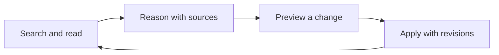

<div align="center">
  
  <h1>kb</h1>
  <p><strong>Knowledge that survives the session.</strong></p>
  <p>A local Markdown knowledge base with a Go CLI and MCP server.<br />Search what you know, read the evidence, and record what you learn.</p>
</div>

<p align="center">
  <a href="https://github.com/matheus3301/kb/actions/workflows/ci.yml"></a>
  <a href="https://github.com/matheus3301/kb/blob/main/go.mod"></a>
  <a href="LICENSE"></a>
  <a href="#project-status"></a>
</p>

`kb` gives humans and agents the same memory to work with. Notes stay in readable
[OKF](https://github.com/GoogleCloudPlatform/open-knowledge-format) Markdown.
PARA is optional navigation. Your agent handles reasoning and synthesis; `kb`
handles retrieval, references, and changes you can review.

## Getting started

For Homebrew and prebuilt binaries, see [installation](docs/installation.md)
and [published releases](https://github.com/matheus3301/kb/releases). To build
from source, use the Go version declared in
[go.mod](https://github.com/matheus3301/kb/blob/main/go.mod), and put Go's binary
installation directory on your `PATH`:

```sh
git clone https://github.com/matheus3301/kb.git
cd kb
go install ./cmd/kb

export KB_ROOT="$PWD/example-knowledge"
kb init --para
```

Create your first note:

```sh
kb create --input - <<'JSON'
{
  "path": "03_Resources/decisions.md",
  "type": "Reference",
  "title": "Project decisions",
  "body": "# Project decisions\n\nSearch existing notes before adding new ones.\n",
  "summary": "Record the memory workflow",
  "actor": "process:quickstart",
  "idempotency_key": "quickstart/create-decisions"
}
JSON

kb search "project decisions" --json
kb read 03_Resources/decisions.md --json
kb context "search existing notes" --max-tokens 1000 --json
kb validate --profile okf --json
```

`KB_ROOT` points to the knowledge directory; note paths are relative to that
root. Run `kb --help` to explore commands, or follow the
[full quickstart](docs/quickstart.md) for revision-checked edits, coordinated
plans, recovery, and export.

## Why kb

| You need | kb provides |
| --- | --- |
| Memory you can open in an editor | Native OKF Markdown and optional PARA folders; see current fidelity limits below. |
| Evidence behind an answer | Lexical search and bounded context with paths, revisions, and line references. |
| Reviewable changes | Dry-runs, expected revisions, and coordinated create/patch/move/archive plans. |
| Reliable retries | A durable write journal, explicit recovery, and idempotency receipts. |
| One interface across tools | JSON CLI output and an official-SDK MCP stdio server over the same core. |
| A base that stays navigable | Link updates, managed index regions, format/health checks, and validated export. |

The binary runs locally without a model, Node, Git, credentials, or network
access. Original source snapshots stay outside the writable knowledge bundle.

## Connect your agent

### MCP

Add a stdio server to your MCP client's configuration. This generic example
starts with read-only access:

```json
{
  "mcpServers": {
    "kb": {
      "command": "kb",
      "args": ["--root", "./example-knowledge", "mcp", "--read-only"]
    }
  }
}
```

Use the intended client working directory or replace the root with your own
absolute path. The server stays bound to that root. Remove `--read-only` when
you deliberately enable writes. See the [interface contract](docs/interfaces.md)
for tools, limits, and errors.

### Agent skill

Install the optional [knowledge-memory skill](skills/knowledge-memory/SKILL.md)
from your agent workdir:

```sh
npx skills add matheus3301/kb --skill knowledge-memory
```

Then configure the knowledge root and add a workdir instruction to consult it
before answering and record reusable learning. The skill installer needs
Node/npx; the Go binary does not. Binary installation, skill installation, and
MCP registration are separate. An `AGENTS.md` inside the knowledge base is
optional. See [activation instructions](docs/quickstart.md#optionally-install-the-agent-skill).

## The memory workflow



Use existing concepts before creating new ones. Incorporate new evidence across
affected notes, preserve provenance, and review changed synthesis dependencies.
Queries do not add history entries; a session without new learning needs no
write. Format and health checks help an external agent review the base; they do
not establish semantic truth.

## Project status

**Experimental, with a working CLI, MCP server, and skill.** The
[GoReleaser workflow](docs/releases.md) publishes Linux/macOS binaries and a
checksummed source archive, then updates the
[Homebrew tap](https://github.com/matheus3301/homebrew-tap) for stable releases.
See [published versions](https://github.com/matheus3301/kb/releases) and
[installation instructions](docs/installation.md). The source checkout remains
an installation option independent of the release channel.

[Recorded validation](docs/evidence/validation.json) includes 88.4% statement
coverage, Linux/macOS tests, seven fuzz targets, CLI/MCP parity, failure/recovery
tests, and a controlled skill consumer. These are observed results, not a
promise that all bugs are absent or every agent activates the skill.

[Native Homebrew QA of v0.1.1](docs/qa/native-homebrew-v0.1.1.md) found two
move fidelity defects: automatic reference rewrites can round precise decimals
and discard nested YAML comments in dependent metadata. The source correction
now passes the [fidelity regressions](docs/evidence/move-fidelity-fix.json),
including the original reproducer. **Version v0.1.1 remains affected**.
v0.1.2 fixes those cases, but installed-package QA found that clearing
`verified` can lose a trailing YAML annotation. Choose v0.1.3 or later when
available in the published releases, or build current source. See the
[regression and correction](docs/qa/verification-footer-regression.md).
The original report includes concurrency,
recovery, and installed CLI/MCP measurements; experimental status remains.

The initial performance targets remain unmet: on 10,000 synthetic 2 KiB notes,
warm core search p95 was **162.9 ms** and peak process RSS **180.3 MiB**, against
150 ms / 150 MiB targets. Read the [measurement conditions](docs/performance.md).

Native OKF is required; legacy collection migration is outside this version.
Writes use advisory locks, so external editors can race and external readers can
observe intermediate multi-file states. Preserve `.kb/state/` for recovery and
retries, and restart a long-lived MCP process after configuration changes.

## Documentation

- [Installation](docs/installation.md) and [release operations](docs/releases.md).
- [Full quickstart](docs/quickstart.md) — initialize, query, write, recover, and export.
- [Product and architecture](docs/project-overview.md) — how the pieces fit together.
- [Specification](docs/spec.md) and [interface contract](docs/interfaces.md).
- [Acceptance evidence](docs/acceptance.json), [quality gates](docs/quality.md), and [performance](docs/performance.md).
- [Installed v0.1.1 QA and next-version priorities](docs/qa/native-homebrew-v0.1.1.md).
- [Research](docs/research.md) and [implementation decisions](docs/decisions/0002-v0.1.md).
- [Contributing](CONTRIBUTING.md) and [security](SECURITY.md).

## Contributing

Use the pinned Go toolchain and Python 3.12 or newer:

```sh
make tools
make check
```

Keep changes small, write Conventional Commit subjects and PR titles, and use
synthetic fixtures. See [CONTRIBUTING.md](CONTRIBUTING.md) for the complete checks.

## License

[MIT](LICENSE). Third-party dependency notices accompany release archives.
