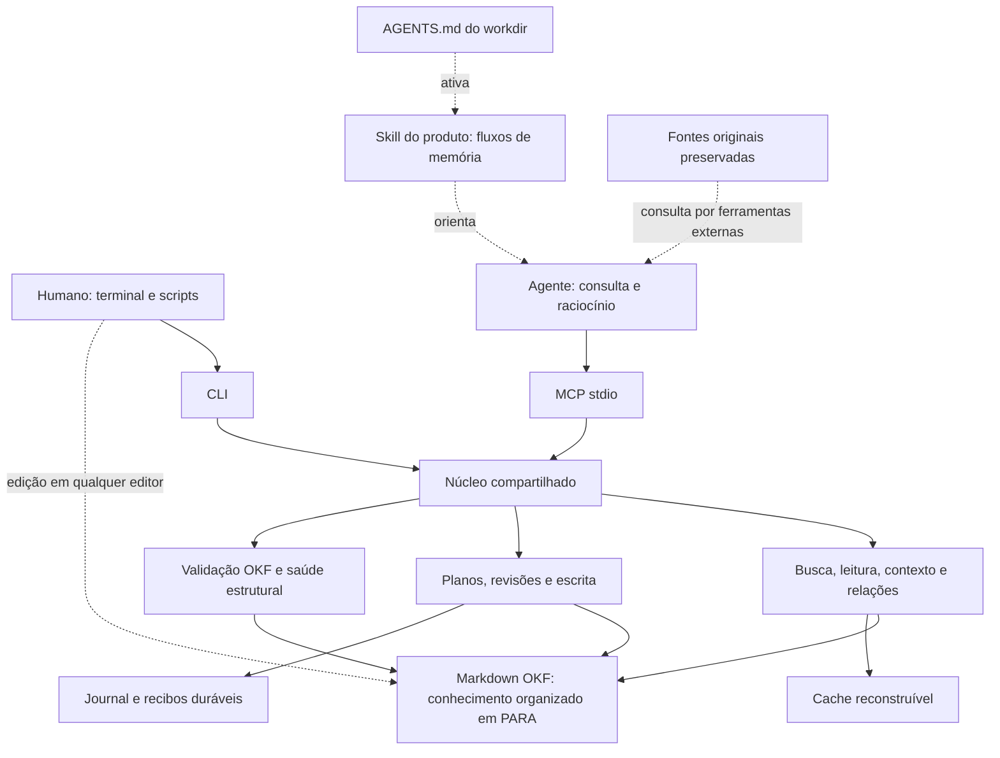
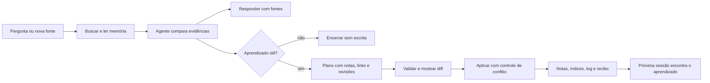

# Desenho do projeto

Será uma ferramenta local para transformar uma pasta de conhecimento em memória
consultável e editável por humanos e agentes. Um único binário terá dois modos:
comandos CLI para terminal e scripts, e servidor MCP stdio para ferramentas de
agentes. Ambos usam as mesmas regras, revisões e operações.

O conhecimento permanece em arquivos Markdown OKF. PARA organiza a navegação
humana. O agente consulta a base, raciocina sobre as evidências e propõe mudanças;
a ferramenta localiza, valida e aplica essas mudanças de forma controlada. O
AGENTS.md do workdir declara quando consultar e registrar aprendizado, apontando
para a skill distribuída com o produto e para a base configurada. AGENTS.md dentro
da base é opcional. A ferramenta expõe essa capacidade; a adoção das instruções
depende do agente e de sua configuração.

## Arquitetura



As três responsabilidades do produto são:

| Responsabilidade | Resultado para quem usa |
| --- | --- |
| Encontrar contexto | Busca lexical, filtros, trechos com linhas e revisão, leitura por seção e relações entre notas. |
| Manter conhecimento | Criar, corrigir, mover e arquivar notas; aplicar um plano sobre várias notas com controle de revisão, índices e log. |
| Inspecionar a memória | Diagnosticar formato inválido, links quebrados, notas fora do índice e sínteses cujas fontes mudaram. |

O núcleo não executa um LLM nem pesquisa a web. As consultas locais funcionam
sem modelo, conta, rede, Git ou UI. O agente consumidor pode usar um modelo e
ferramentas externas. Embeddings, sincronização e transportes remotos são futuras
extensões, sem requisito no MVP.

## Onde ficam as coisas

Exemplo de instalação nova, ainda sem migração do acervo atual:

```text
repositorio/
  AGENTS.md                 opcional: se esta pasta for um workdir
  sources/                  versões preservadas das fontes originais
  knowledge/                raiz OKF configurada
    index.md                mapa de entrada
    log.md                  mudanças úteis da memória
    00_Inbox/               capturas a classificar
    01_Projects/            trabalhos ativos com resultado e término
    02_Areas/               responsabilidades contínuas
    03_Resources/           conhecimento reutilizável
    04_Archive/             conteúdo inativo
    .kb/config.toml         configuração local
    .kb/cache/              índice de busca reconstruível
    .kb/state/              recuperação e recibos de operações
```

OKF define notas, metadados e relações; PARA é o perfil de pastas escolhido
para leitura humana. `type` é obrigatório nas notas de conceito. Fontes, datas,
estado e outros metadados ajudam a avaliar o conhecimento. O ID é derivado do
caminho. Índices e logs são arquivos reservados com regras próprias.

Fontes originais ficam fora da raiz validada e não são editadas pela CLI. Sua
aquisição e preservação pertencem ao workflow externo. Uma nota OKF registra a
origem e permite ligar conceitos e sínteses à evidência usada.

## Uma sessão de aprendizado



Exemplo: a pergunta “Zap ou slog para este projeto?” recupera decisões existentes
e suas fontes. O agente compara o que encontrou com a nova pesquisa e responde.
Se houver uma conclusão reutilizável, propõe atualizar a decisão do projeto e
a nota de referência sobre logging, com links à evidência. O plano valida as
revisões e publica as alterações, mantendo índice e histórico.

Se outra sessão editou uma nota após a leitura, a operação retorna conflito e
exige releitura. Um retry identificado pela mesma chave não deve duplicar seus
efeitos. Esses mecanismos são requisitos da spec, ainda não implementados.

Uma síntese pode registrar as revisões das notas que a sustentam. Quando alguma
delas muda, a ferramenta sinaliza necessidade de revisão. O agente analisa se a
conclusão continua válida. Nada declara automaticamente que ela se tornou falsa.
Uma consulta sem aprendizado não gera uma nota ou evento apenas para registrá-la.

## Skill e vínculo com o workdir

O repositório do produto terá `skills/knowledge-memory/SKILL.md`, separado do
conteúdo da base. A skill carrega o procedimento reutilizável; o workdir informa
a raiz e exige sua consulta em toda pergunta. Uma mesma base pode atender vários
workdirs, cada um configurado explicitamente.

Modelo de instrução a adaptar ao agente e à instalação:

```text
Antes de responder a qualquer pergunta, use a skill knowledge-memory para
consultar a base configurada em KB_ROOT (ou no servidor MCP associado).
Registre aprendizados reutilizáveis conforme a skill; não grave consultas
sem novidade. Se a base estiver indisponível, informe isso e prossiga.
```

A instalação documentada pelo Skills CLI usa `npx skills add`, com seleção por
`--skill`. Isso distribui instruções. Instalação do executável e registro MCP
continuam etapas próprias. O setup do produto deverá integrar essas etapas de
forma explícita no workdir escolhido. Nenhuma skill foi criada ou instalada
nesta revisão; o AGENTS.md atual da knowledge base foi preservado.

## Forma de uso proposta

`kb` é o nome escolhido. Os comandos ainda não existem:

```sh
kb --root ./knowledge search "decisão sobre logging" --json
kb --root ./knowledge read 01_Projects/exemplo/logging.md --json
kb --root ./knowledge context "logging do projeto" --max-tokens 2000 --json
kb --root ./knowledge apply --input plano.json --dry-run
kb --root ./knowledge apply --input plano.json
kb --root ./knowledge validate --profile health --json
kb --root ./knowledge mcp
```

No MCP, o agente acessará ferramentas como `kb_search`, `kb_read`, `kb_context`
e `kb_apply`. Não precisará montar comandos de shell com conteúdo de notas.
CLI e MCP devem produzir os mesmos resultados de domínio. O modo read-only
permite consultas e bloqueia mutações.

## Prontidão e limites

**Pronta para o protótipo; ainda não fechada para implementação integral.** A
spec define o produto, o modelo de conhecimento, as interfaces e 26 critérios
de aceite. Os testes de ferramentas existentes sustentam decisões de desenho;
não validam a nossa implementação, que ainda não começou.

Faltam quatro fechamentos, registrados também na spec:

1. Schemas completos e versionados das operações, seus resultados e erros.
2. Máquina de estados de commit/recuperação e retenção de recibos. Resolver o
   comportamento de leituras quando houver recuperação pendente.
3. Contrato explícito de reparo de base inválida, inicialização e setup da
   integração no workdir. O posicionamento das instruções foi definido acima.
4. Escolha de parser, busca e SDK, com versões e evidência obtida no protótipo.

Go é a baseline adotada no bootstrap. A proposta é Cobra na CLI, SDK oficial
no MCP, composição por construtores explícitos e slog para diagnóstico; Zap
é alternativa válida. Fx não tem necessidade demonstrada nesta etapa. Essas
recomendações ainda não representam dependências fixadas ou instaladas.

## Entrega

O primeiro protótipo deve atravessar um caminho completo: ler uma nota OKF,
preservar comentários YAML ao editar, rejeitar uma revisão em conflito e expor
uma operação pelo MCP. Em paralelo, ele permite avaliar parser e distribuição.

A implementação avança pelos incrementos da spec: leitura e validação; busca e
contexto; escrita coordenada e recuperação; movimentação e saúde; integração MCP
completa, exportação e distribuição. Recuperação e idempotência precisam ser
demonstradas com falhas injetadas antes de oferecer escrita estável aos agentes.

O resultado esperado é que uma sessão futura consiga encontrar a decisão,
entender sua razão e suas fontes, e revisá-la sem perder o trabalho de outra
sessão. Desempenho e tamanho do binário ainda precisam ser medidos.
