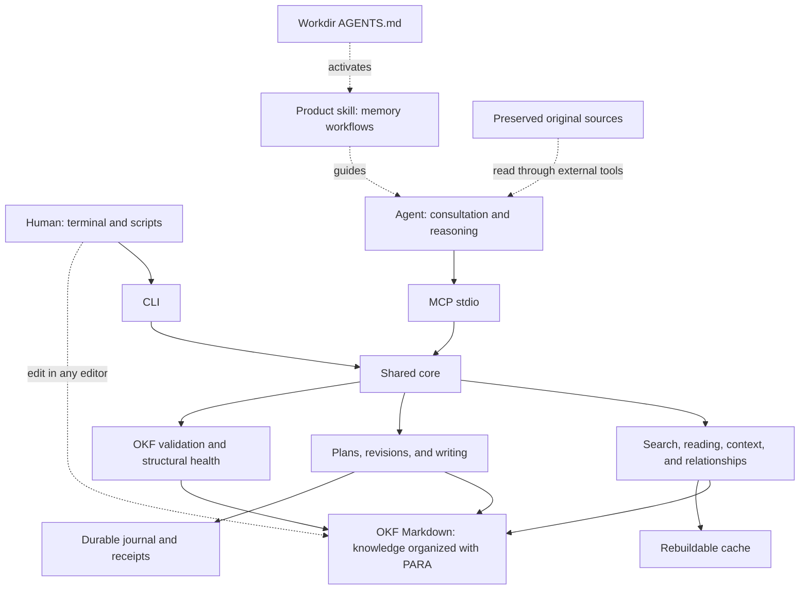
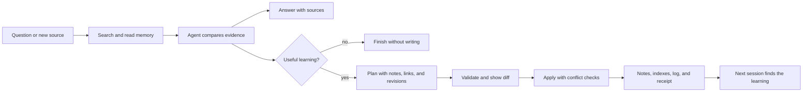

# Project design

The authoritative v0.1 clarification is `docs/interfaces.md` in this repository;
shared DTOs are in `internal/api/types.go`. They settle implementation details
of the [specification](spec.md). These contracts are integrated separately from
this documentation preparation.

This will be a local tool that turns a knowledge folder into memory that humans
and agents can query and edit. One binary will provide two modes: CLI commands
for terminals and scripts, and an MCP stdio server for agent tools. Both use
the same rules, revisions, and operations.

Knowledge remains in OKF Markdown files. PARA organizes human navigation. The
agent consults the base, reasons about evidence, and proposes changes; the tool
locates, validates, and applies those changes in a controlled way. Workdir
AGENTS.md instructions declare when to consult and record learning, pointing to
the product skill and configured base. AGENTS.md inside the base is optional.
The tool exposes this capability; adoption of instructions depends on the agent
and its configuration.

## Architecture



The product has three responsibilities:

| Responsibility | User outcome |
| --- | --- |
| Find context | Lexical search, filters, excerpts with lines and revisions, section reading, and relationships between notes. |
| Maintain knowledge | Create, correct, move, and archive notes; apply a plan across multiple notes with revision checks, indexes, and log maintenance. |
| Inspect memory | Diagnose invalid format, broken links, unindexed notes, and syntheses whose sources changed. |

The core neither runs an LLM nor searches the web. Local queries work without
a model, account, network, Git, or UI. The consuming agent may use a model and
external tools. Embeddings, synchronization, and remote transports are future
extensions, not MVP requirements.

## Where things live

Example new installation, without migration of an existing collection:

```text
workspace/
  AGENTS.md                 # optional: if this folder is an agent workdir
  sources/                  # preserved versions of original sources
  example-knowledge/        # configured OKF root
    index.md                # entry map
    log.md                  # useful memory changes
    00_Inbox/               # captures awaiting classification
    01_Projects/            # active work with an outcome and end
    02_Areas/               # ongoing responsibilities
    03_Resources/           # reusable knowledge
    04_Archive/             # inactive content
    .kb/config.toml         # local configuration
    .kb/cache/              # rebuildable search index
    .kb/state/              # recovery and operation receipts
```

OKF defines notes, metadata, and relationships; PARA is the folder profile
chosen for human reading. `type` is required in concept notes. Sources, dates,
status, and other metadata help assess knowledge. The ID derives from the
path. Indexes and logs are reserved files with their own rules.

Original sources stay outside the validated root and are not edited by the
CLI. Acquisition and preservation belong to the external workflow. An OKF
note records provenance and connects concepts and syntheses to their evidence.
Deleting `.kb/cache/` loses no knowledge; `.kb/state/` is durable operational
state and must be preserved for pending recovery and idempotent retries.

## A learning session



For example, “Zap or slog for this project?” retrieves existing decisions and
their sources. The agent compares them with new research and answers. If a
reusable conclusion emerges, it proposes updating the project decision and
logging reference note with evidence links. The plan validates revisions and
publishes changes while maintaining the index and history.

If another session edited a note after it was read, the operation returns a
conflict and requires rereading. A retry identified by the same key must not
duplicate effects. These are specification requirements, not implemented
mechanisms yet. Multi-file publication requires a durable journal and recovery;
external editors and readers cannot be promised atomic multi-file visibility.

A synthesis can record revisions of supporting notes. When one changes, the
tool signals a need for review. The agent assesses whether the conclusion
remains valid. Nothing automatically declares it false. A query without
learning creates no note or event merely to record the query.

## Skill and workdir integration

The product repository will contain `skills/knowledge-memory/SKILL.md`, separate
from base content. The skill carries the reusable procedure; workdir instructions
identify the root and require consultation on every question. One base can serve
several workdirs, each configured explicitly.

Example instruction to adapt to the agent and installation:

```text
Before answering any question, use the knowledge-memory skill to consult the
base configured through KB_ROOT (or the associated MCP server). Record reusable
learning according to the skill; do not record queries without new information.
If the base is unavailable, report that and continue.
```

The Skills CLI's documented installation uses `npx skills add` with `--skill`
selection. This distributes instructions. Executable installation and MCP
registration remain separate steps. Product setup should integrate them
explicitly in the selected workdir. This documentation revision creates or
installs no skill and modifies no knowledge-base instructions. See the
[quickstart](quickstart.md) for the planned installation steps.

## Proposed usage

`kb` is the chosen name. These commands do not exist yet:

```sh
kb --root ./example-knowledge search "logging decision" --json
kb --root ./example-knowledge read 01_Projects/example/logging.md --json
kb --root ./example-knowledge context "project logging" --max-tokens 2000 --json
kb --root ./example-knowledge apply --input plan.json --dry-run
kb --root ./example-knowledge apply --input plan.json
kb --root ./example-knowledge validate --profile health --json
kb --root ./example-knowledge mcp
```

Through MCP, the agent will access tools such as `kb_search`, `kb_read`,
`kb_context`, and `kb_apply` without constructing shell commands from note
content. CLI and MCP must produce the same domain results. Read-only mode
permits queries and blocks mutations, including direct calls to hidden write tools.

## Readiness and limits

**Ready for implementation against the v0.1 contract; still pre-release.** The spec
defines the product, knowledge model, interfaces, and 26 acceptance criteria.
Tests of existing tools inform design decisions; they do not validate this
application, whose implementation has not started.

The v0.1 clarification settles the earlier contract gaps:

1. Versioned `kb.v1` DTOs define operation, result, and error shapes. Writes
   require explicit paths and revision preconditions.
2. A prepared/committed journal controls rollback or roll-forward; receipts do
   not expire in v0.1. Reads return `RECOVERY_REQUIRED` without changing notes;
   recovery is explicit or precedes a new mutation.
3. `apply --repair` permits invalid input state and requires a conformant final
   state. First init uses an explicit root, `KB_ROOT`, or the current directory.
   Workdir instructions and integration setup remain explicit and separate.
4. Go is the adopted implementation language. Parser, search, and official MCP
   SDK versions and behavior still need prototype evidence. Cobra is the CLI
   adapter candidate; explicit constructors and slog are the starting point.
   Zap remains a valid alternative; Fx has no demonstrated need. Recommendations
   alone are not installed or pinned dependencies.

## Delivery

The first prototype should traverse a complete path: read an OKF note, preserve
YAML comments during editing, reject a conflicting revision, and expose one
operation through MCP. It also permits evaluating the parser and distribution.

Implementation follows the spec's increments: reading and validation; search
and context; coordinated writing and recovery; moving and health; complete MCP
integration, export, and distribution. Recovery and idempotence must be
demonstrated with injected failures before stable agent writing is offered.

The expected outcome is that a future session can find a decision, understand
its reasons and sources, and revise it without losing another session's work.
Performance and binary size still need measurement.
