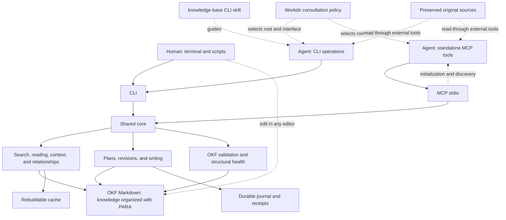
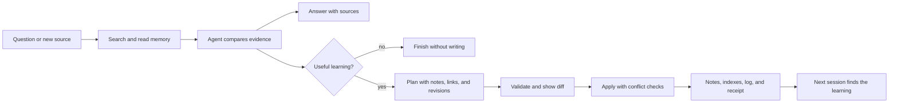

# KB — Knowledge Base project design

The [interface contract](interfaces.md), shared DTOs and [specification](spec.md)
describe the local CLI and stdio MCP interfaces at the checked-out revision.
Use the installed binary's tagged documentation for shipped behavior. The
[compatibility policy](compatibility.md), [README project status](../README.md#project-status)
and [exit checklist](stability.md) centralize current release/qualification facts;
source integration, readiness, publication and installation are separate.

`kb` is a local Markdown Knowledge Base that humans and AI agents can search,
read, and update. One binary provides two modes: CLI commands
for terminals and scripts, and an MCP stdio server for agent tools. Both use
the same rules, revisions, and operations.

Knowledge Base notes remain in OKF Markdown files. PARA organizes human navigation. The
agent consults the base, reasons about evidence, and proposes changes; the tool
locates, validates, and applies those changes in a controlled way. Workdir
AGENTS.md instructions declare when to consult and record learning, pointing to
the product skill and configured base. AGENTS.md inside the base is optional.
The tool exposes this capability; adoption of instructions depends on the agent
and its configuration.

## Architecture



The product has three responsibilities:

| Responsibility | User outcome |
| --- | --- |
| Find context | Lexical search, filters, excerpts with lines and revisions, section reading, and relationships between notes. |
| Maintain knowledge | Create, correct, move, and archive notes; apply a plan across multiple notes with revision checks, indexes, and log maintenance. |
| Inspect memory | Diagnose invalid format, broken links, unindexed notes, and syntheses whose sources changed. |

The core neither runs an LLM nor searches the web. Local queries work without
a model, account, network, Git, or UI. The consuming agent may use a model and
external tools. Embeddings, synchronization, and remote transports are future
extensions, not MVP requirements.

## Where things live

Example new installation, without migration of an existing collection:

```text
workspace/
  AGENTS.md                 # optional: if this folder is an agent workdir
  sources/                  # preserved versions of original sources
  example-knowledge/        # configured OKF root
    index.md                # entry map
    log.md                  # useful memory changes
    00_Inbox/               # captures awaiting classification
    01_Projects/            # active work with an outcome and end
    02_Areas/               # ongoing responsibilities
    03_Resources/           # reusable knowledge
    04_Archive/             # inactive content
    .kb/config.toml         # local configuration
    .kb/cache/              # rebuildable search index
    .kb/state/              # recovery and operation receipts
```

OKF defines notes, metadata, and relationships; PARA is the folder profile
chosen for human reading. `type` is required in concept notes. Sources, dates,
status, and other metadata help assess knowledge. The ID derives from the
path. Indexes and logs are reserved files with their own rules.

Original sources stay outside the validated root and are not edited by the
CLI. Acquisition and preservation belong to the external workflow. An OKF
note records provenance and connects concepts and syntheses to their evidence.
Deleting `.kb/cache/` loses no knowledge; `.kb/state/` is durable operational
state and must be preserved for pending recovery and idempotent retries.

Since v0.4.0, [operational backup/restore](backups.md) provides versioned
checksummed archives preserving exact included files, configuration and settled
receipts, not pending journals or disposable cache. Storage is confined under
`.kb/backups` and `.kb/restores`; restore creates a new root and publishes config
last without switching the active MCP root. Excluded/external sources need separate
protection. Same-disk staging is not off-disk disaster recovery.

## A learning session



For example, “Zap or slog for this project?” retrieves existing decisions and
their sources. The agent compares them with new research and answers. If a
reusable conclusion emerges, it proposes updating the project decision and
logging reference note with evidence links. The plan validates revisions and
publishes changes while maintaining the index and history.

If another session edited a note after it was read, the operation returns a
conflict and requires rereading. A retry identified by the same key must not
duplicate effects. The implementation uses revision checks, durable receipts,
and a prepared/committed journal with recovery;
external editors and readers cannot be promised atomic multi-file visibility.

A synthesis can record revisions of supporting notes. When one changes, the
tool signals a need for review. The agent assesses whether the conclusion
remains valid. Nothing automatically declares it false. A query without
learning creates no note or event merely to record the query.

## Skill and workdir integration

Agents choose CLI + skill or MCP with self-contained server/tool guidance. The
CLI skill is not a dependency of the MCP interface.

The product repository contains [skills/knowledge-base/SKILL.md](../skills/knowledge-base/SKILL.md), separate
from base content. The skill carries the reusable procedure; workdir instructions
identify the root and require consultation on every question. One base can serve
several workdirs, each configured explicitly.

Example instruction to adapt to the agent and installation:

```text
Before answering any question, use the knowledge-base skill to consult the
base configured through KB_ROOT using the kb CLI. Record reusable
learning according to the skill; do not record queries without new information.
If the base is unavailable, report that and continue.
```

The Skills CLI's documented installation uses `npx skills add` with `--skill`
selection. This distributes instructions. Executable installation and MCP
registration remain separate steps. Configure the root and workdir instructions
explicitly; installation does not change global agent settings. See the
[quickstart](quickstart.md) for working setup commands. The
[controlled consumer observation](evidence/consumer/consumer-evidence.json) used
an explicitly loaded local skill and an external base without AGENTS.md. It
does not establish automatic activation across agents.

## Usage

With a configured example base and an existing logging note:

```sh
kb --root ./example-knowledge search "logging decision" --json
kb --root ./example-knowledge read 01_Projects/example/logging.md --json
kb --root ./example-knowledge context "project logging" --max-tokens 2000 --json
kb --root ./example-knowledge apply --input plan.json --dry-run
kb --root ./example-knowledge apply --input plan.json
kb --root ./example-knowledge validate --profile health --json
kb --root ./example-knowledge mcp
```

Through MCP, the agent accesses tools such as `kb_search`, `kb_read`,
`kb_context`, and `kb_apply` without constructing shell commands from note
content. CLI and MCP must produce the same domain results. Read-only mode
permits queries and blocks mutations, including direct calls to hidden write tools.

## Evidence and limits

The implementation includes native OKF parsing and presentation-preserving
patches, lexical search, bounded context, writes with expected revisions,
coordinated plans, move/archive, journal recovery, maintenance, export, operational
backup/restore, and MCP. Retrieval evaluation is a separate synthetic CLI/MCP gate,
not an embedded semantic model.
The [runtime decision](decisions/0002-v0.1.md) records Go and the selected
libraries. No embedded model or legacy-note migration is provided.

Reads encountering a pending journal return `RECOVERY_REQUIRED` without note
mutation. Explicit recovery or a subsequent note mutation resolves pending state;
backup/restore instead refuse it until explicitly recovered.
Receipts currently do not expire. Repair is an explicit plan, requires a conformant
final state by default, and remains subject to operational size limits. Explicit
[incremental repair](decisions/0004-incremental-repair.md) permits bounded progress
while preserving untouched invalid notes. External readers
can observe intermediate multi-file states; advisory locking does not isolate
against editors that ignore it.

Configuration is process-scoped. CLI invocations open fresh configuration;
restart a long-lived MCP server after `.kb/config.toml` changes. The server
stays at its startup root and uses the official Go SDK. Read-only mode hides
write tools and rejects direct mutation calls; tool annotations do not enforce
permissions.

Application policies distinguish valid OKF from supported operational input:
notes over 1 MiB are invalid, scoped source files over 4 MiB abort inventory,
non-string YAML mapping keys produce policy findings, and read/context responses
have a 256 KiB ceiling. These limits are not imposed by OKF itself.

[Original validation](evidence/validation.json), dated 2026-10-24, reports
88.4% statement coverage, 102 top-level test functions, 314 named pass events
including subtests and seeds, seven fuzz targets, and four CGO-free cross-builds.
These are historical counts, not current suite totals. The
[CLI workflow](evidence/cli-workflow.json) and consumer observation exercise
synthetic data. Evidence supports observed behavior, not absence of bugs,
universal agent adherence or semantic correctness.

The [performance report](performance.md) separates historical v0.1 core misses
(162.9 ms warm p95/180.3 MiB RSS) from the 2026-10-25 v0.3.1 measurements
(117.7 ms/134.0 MiB, with 179.0 ms rebuild p95), meeting the original local
150 ms/150 MiB/10 s targets. Core runs used Apple M4/macOS arm64, Go 1.27.3,
10,000 synthetic 2 KiB notes and 20 warm queries; reindexing was timed separately
in the later run. These are not fresh CLI startup or MCP transport measurements.
That run measured 50k CLI search at 2.19 s median/483.1 MiB RSS. The later
[quiet paired scale report](performance-large-corpus.md) records lower 50k
read/search costs and modest allocation reductions, but 10k non-improvements,
increased preview RSS and a 4.9% slower 50k committed-repair median. Runs retain
separate baselines; neither establishes a portable SLA or uniform improvement.

Source CI runs on ubuntu-24.04 and macos-15, with four cross-build targets.
The required native channels are macOS arm64 Homebrew and Linux amd64 archive/
archived-source execution; Linux arm64 and macOS amd64 remain package/cross-build
only until executed. See the [current evidence boundary](compatibility.md#platform-and-maintenance-support).

The [retrieval report](qa/retrieval-quality.md) adds a public synthetic corpus and
actual CLI/MCP assertions for lexical membership/order, ceiling-aware Recall@5,
citations, revisions, budgets and purity. Backup/archive/fault/concurrency and
real-process interruption regressions extend operational evidence. Qualification
must bind reruns, multi-seed reliability, quiet resource budgets, upgrade/native
packages and independent review to the exact candidate. Historical reports and
model adherence are not substitutes; current outcomes belong in the [exit checklist](stability.md).

The [receipt-history report](qa/backup-performance-v1.md) preserves the failed
v0.4.0 extended attempt and the causal directory-scan repair. Its three-sample
2,000-receipt comparison measured backup median 24.45 s to 0.47 s and restore
23.88 s to 9.93 s on one macOS arm64 host. Restore sync cost and retained-state
growth remain material; these measurements do not replace candidate-specific
30-minute log-disabled/index-enabled and separate 60-second default-log profiles,
quiet resource-budget qualification or final readiness review.

## Delivery

Source installation works through `go install ./cmd/kb` from a checkout. The
earlier manual release was withdrawn; subsequent versions use the
[GoReleaser workflow](releases.md), which prepares Linux/macOS amd64/arm64 archives,
checksums, documentation, skill, licenses, and a source archive. A dedicated
tag-only publisher requires protected-main ancestry and exact-commit CI. A read-only
Linux/macOS matrix then downloads and exercises published native archives and
archived source; only successful publication and the entire matrix unblock the
Homebrew tap update. This is not an installed Homebrew test. Publication requires
an explicit new version tag and, for the non-prerelease tap, its credential.
Configured automation does not prove a job has executed. See [release operations](releases.md)
and [installation](installation.md); merging configuration does not publish.
There is no automatic merge.

A future session can retrieve recorded decisions, reasons, and sources and
propose revision-checked changes. Continuing work must retain conformance,
metadata preservation, recovery, and source evidence while improving measured
performance and expanding behavioral coverage.
