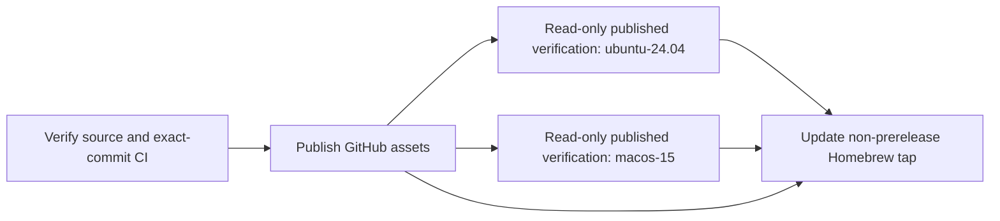

# Releases

Release automation uses GoReleaser **2.19.0**, pinned in `.tool-versions`.
`.goreleaser.yaml` builds four CGO-free binaries, packages the public docs and
licenses, creates a source archive, calculates SHA-256 checksums, and prepares
Conventional Commit changelog groups. The configuration was informed by
[LoopForge's setup](https://github.com/matheus3301/loopforge/blob/b025dce3a2a6fa1903b45475deca8d9f27a70dee/.goreleaser.yaml).

The earlier manual `v0.1.0` tag and release were deliberately removed. Go module
proxies and the checksum database may retain that version; **never reuse
`v0.1.0`**. The first automated publication was `v0.1.1`; it must not be moved
or reused either. Select a new, unused version for subsequent publications.
Merging a change does not publish a release.

This guide describes the configured release flow at the checked-out revision,
not proof of a publication or installation. The [compatibility policy](compatibility.md),
[README project status](../README.md#project-status) and [readiness checklist](stability.md)
centralize current version and qualification facts. Green CI, an experimental tag
or paired improvements alone do not authorize stable publication. Preserve
immutable releases and failed observations; qualify the intended artifact.

## One-time tap credential

Create a fine-grained GitHub token restricted to **matheus3301/homebrew-tap**
with **Contents: read and write**. Store it as `HOMEBREW_TAP_TOKEN` in the
[kb repository's Actions secrets](https://github.com/matheus3301/kb/settings/secrets/actions).
Keep its value out of issues, source, logs, and agent conversations. A token
already stored in another repository cannot be retrieved from GitHub; supply
an existing suitable token from your secret manager or create a new one.

The normal `GITHUB_TOKEN` publishes assets only to `kb`. The tap token is used
only by the tap publication step and the preceding presence check. Stable
publication fails before creating a release when the tap secret is absent.
Prereleases do not need the tap token and never update the stable formula.

## Validate without publishing

Install the GoReleaser version in `.tool-versions` with your tool manager or the
[official installation instructions](https://goreleaser.com/install/).
Then run:

```sh
make tools
make check
make release-snapshot
```

`make release-snapshot` validates the config, builds all targets with
`--snapshot --skip=publish`, generates a Homebrew formula, and inspects actual
archives. It verifies checksums, normalized owners, public docs/licenses, source
and formula identities; installs the extracted host-native binary into a
temporary prefix; and exercises actual acceptance, documentation and independent
CLI/MCP backup/restore consumers there. It builds archived source and repeats
those workflows. Foreign archives are inspected, not executed. No global
installation or GitHub/tap write occurs. Outputs live under ignored
`.build/dist/` and `.build/homebrew/`.

PR CI requires the release snapshot job as part of **CI gate**, alongside the
existing application checks. Unit regressions cover missing/failed exact-commit
CI, malformed versions, the retired tag, checksum tampering, extra Ruby in a
formula, wrong-commit artifacts, duplicate publication, and tap downgrades.

## Publish a new version

Publication is an explicit maintainer action under the current authorization.
A green branch build alone does not request a release.

1. Merge the intended change through a PR with a Conventional Commit title.
2. Wait for **CI gate** to pass on the exact merged `main` commit.
3. Ensure the tap secret is configured for a stable release.
4. Select a new, unused version only after the required readiness/publication authorization.

```sh
git switch main
git pull --ff-only
: "${version:?Set version to a new, unused authorized semantic version}"
git tag -a "$version" -m "Release $version"
git push origin "$version"
```

Run these commands only after the intended version's qualification and explicit
publication authorization. Never move or reuse an existing version tag; verify
the selected new version is unused before tagging. A prerelease publishes GitHub
assets without updating the non-prerelease Homebrew formula.

The [Release workflow](../.github/workflows/release.yml) runs four stages:



1. **Verify**: require a valid tag, reject retired `v0.1.0`, require the tagged
   commit to belong to `origin/main`, require the latest exact-commit **CI gate**
   from the GitHub Actions app to succeed, and rerun `make tools check`.
2. **Publish**: use the sole job-scoped `contents: write` token to run pinned
   GoReleaser. Generate a formula from the checksummed source archive and retain
   it as a workflow artifact for 30 days for non-prereleases.
3. **Verify published**: a read-only, `fail-fast: false` matrix on
   **ubuntu-24.04 and macos-15** downloads the actual published assets for the
   selected tag. Expected version comes from that tag; expected full source
   commit comes independently from checkout HEAD, not downloaded metadata.
   Prepare a local source-formula expectation, then reuse `scripts/check_release.py`
   for checksums/privacy/identity, temporary-prefix native CLI/docs/MCP workflows
   and archived-source execution. Inspect foreign archives without executing them.
4. **Tap**: require successful publication **and every verify-published matrix
   arm**, then download the formula from the same workflow run, reconstruct and
   verify its expected content against the tag/commit, and update only
   `Formula/kb.rb` in `matheus3301/homebrew-tap` using its expected existing SHA.
   Prereleases never update the tap.

For each release, record actual published-verification job outcomes and UTC
timestamps with the [release/channel evidence](compatibility.md#current-qualification-status).
Configuration and snapshots do not establish that outcome. Neither temporary-prefix
installation nor archived-source execution is `brew install`/`brew test`;
separately qualify Homebrew and the final installed identities.

All checkout steps disable persisted credentials; actions use full commit SHAs.
The workflow runs only on version tag pushes. PRs, forks, ordinary main pushes,
and snapshot checks receive no publishing credentials or write permissions.
The narrow policy exception for the tag publisher is tested; it does not grant
write tokens to other CI jobs. Main branch protection is unchanged.

## Homebrew design

Homebrew installs `kb` from a checksummed GoReleaser source archive and compiles
with Go. The formula sets the same version and full commit as binary releases,
uses `std_go_args`, and tests version output plus initialization/validation.
Its automation commits use a public bot identity and Conventional Commit titles.

GoReleaser's legacy `brews` generator, used by the reference setup, is
[deprecated](https://goreleaser.com/resources/deprecations/#brews).
The replacement cask integration distributes macOS binaries. A standard
[source formula](https://docs.brew.sh/Formula-Cookbook) supports macOS and Linux
and avoids requiring an unsigned-binary quarantine workaround. Prebuilt
binaries remain available directly from GitHub releases.

## Recovery and verification

If only the tap job fails after a release exists, rerun **failed jobs** in that
workflow run. This reuses the formula artifact and does not rebuild or replace
published assets. Publication is idempotent for identical formula content;
a retry of an older version cannot downgrade a newer tap formula. Different
tag runs serialize their tap jobs. Unexpected external changes cause a SHA
conflict rather than a blind overwrite.

If published verification fails, assets may already exist but the tap must remain
blocked. Diagnose the failure and rerun the failed verification jobs against the
same immutable assets and independent identities. Do not replace artifacts or
publish a formula to bypass a failed matrix. This flow does not unpublish assets
or provide automatic rollback.

If artifact retention has expired, regenerate the formula from the published
source archive, exact commit, and its verified checksum in a reviewed maintenance
change. Do not replace published binaries just to repair a formula update.

After each authorized publication, verify anonymous downloads and hashes,
`kb version --json` against the release source commit, and a real
`brew install matheus3301/tap/kb` / `brew test matheus3301/tap/kb` on the intended
platforms. Snapshot validation does not replace a real installation test after
publication. Update public installation guidance to match observed results.

## Finalizing stable v1

Keep candidate readiness, publication and installed verification distinct. Earlier
release installation/formula, asset/checksum and CLI + skill/MCP observations do
not qualify later artifacts. D04 requires actual macOS arm64 Homebrew and Linux
amd64 native archive/archived-source workflows; Linux arm64 and macOS amd64 remain
package/cross-build-only. Current evidence belongs in the
[compatibility policy](compatibility.md) and [exit checklist](stability.md).

Use the [finalization checklist](stability.md#finalization-checklist) to bind
measured V01–V07 outcomes, reviewer findings/dispositions and the explicit V08
decision to one candidate. Both immutable v0.3.1 and v0.4.0 compatibility origins
must pass; capable prior binaries must themselves produce archives consumed by
the candidate. Candidate-specific extended reliability and the quiet resource
envelope must pass without hiding failed attempts or changing ceilings.
Preserve historical evidence and identify any source change between qualified
and released artifacts; rerun affected checks.
Do not fabricate human approval, candidate results or release URLs. After an
authorized stable tag, separately verify real downloads, checksums, version/commit,
Homebrew upgrade/formula and installed CLI/MCP before updating current status to
published/installed v1.0.0. Retain support and rollback limits in the release record.

