# Setup architecture: installation and each harness

This document describes the **implemented `kb setup` source candidate** in this
PR. Published v1.0.0 does not include it. The diagrams describe the code's
configuration and execution paths, not a claim that every native host/version
has been exercised. For commands, see [agent setup](agent-setup.md); for observed
native runs, see [acceptance](setup-acceptance.md).

**For Codex specifically:** setup adds a managed KB policy to the selected
`AGENTS.md` or existing nonempty `AGENTS.override.md`. CLI mode installs the
complete `knowledge-base` skill. MCP mode instead registers a local server in
`config.toml`. With `--hooks auto` or `--hooks required`, it also registers
`SessionStart` and `UserPromptSubmit` commands in `hooks.json`. It records the
selected collection path in KB's private setup state. It does not approve
Codex trust or prove that a running Codex session loaded these files.

## What the pieces mean

| Piece | What setup actually does |
| --- | --- |
| Collection root | Selects one canonical directory containing the Knowledge Base. Reuses it, or initializes it only with explicit `--create`. It does not copy the collection into each harness. |
| Project root | Selects where native project configuration belongs and the anchor used for routing. It can differ from the collection root. |
| Binding | Records agent, scope, project, collection root, interface, consultation/learning/hook policy, skill directory and executable. |
| Rule / instruction | Installs a host- and scope-guarded policy telling the model when and how to consult the selected base. These are instructions, not enforced model compliance. |
| CLI skill | Copies the embedded `SKILL.md` and all five reference documents into the host's skill directory, only in CLI mode. No online skill download is needed. |
| MCP registration | Configures the host to launch the existing local stdio server with a fixed collection root, only in MCP mode. No CLI skill is required by the MCP consumer. |
| Hook / extension | On supported hosts, invokes a bounded read-only retrieval handler on native events and supplies its context to the session. It never automatically records learning. |
| Ownership and recovery | Tracks exactly which files, blocks, entries and hook-array items KB owns, borrows or shares, so reconciliation and uninstall preserve other content. |

There is no separate installed “root plugin,” new daemon, embedded model,
automatic Git sync, or remote collection service. MCP is a child process launched
by the harness; the CLI and hook handlers are individual process invocations.

## Installation: choices to published files

On a new integration the defaults are CLI mode, `consult=always` and
`hooks=auto`. Learning must be selected; automation must supply complete choices.
Reconciliation can inherit omitted choices from an existing binding. An unchanged
bare setup can inspect the existing integration instead of reinstalling it.

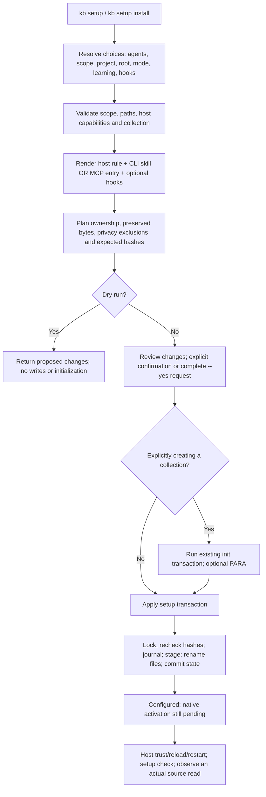

Invalid inputs or conflicts stop planning before publication. `--yes` accepts a
complete plan; it does not authorize replacing customized content. Apply checks
the snapshots again, so a reviewed plan cannot silently overwrite a later edit.
Each file publication is atomic; the whole multi-file operation is recoverable,
not globally atomic. Explicit collection creation is a separate transaction: if
agent publication later fails, setup preserves the deliberately created base.

The installer runs locally without fetching rules or skills, logging in to a
provider, or downloading a harness. Native authentication and trust stay with the
host. [The source installer guide](agent-install.md) covers executable selection.

### What changes for each option

| Choice | Rule | CLI skill | MCP entry | Native hooks |
| --- | --- | --- | --- | --- |
| `--mode cli` | CLI policy and scoped resolver | Complete bundled skill | None added for this integration | Independent of mode |
| `--mode mcp` | MCP-only policy | None added for this integration | `knowledge-base` stdio server | Independent of mode |
| `--hooks auto` | Retained | Depends on mode | Depends on mode | Installed where implemented; otherwise diagnostic and baseline only |
| `--hooks required` | Retained | Depends on mode | Depends on mode | Unsupported adapter fails preflight |
| `--hooks off` | Retained | Depends on mode | Depends on mode | None for this integration |
| `--learning off` | Requests consultation only | Data calls must use `--read-only` | Server gets `--read-only` | Always read-only, regardless of learning policy |
| `--learning on` | Supported learning with provenance, current revisions and preview/apply | Uses writing workflow when appropriate | Write-capable tools subject to normal validation | Still never writes notes |

Changing mode reconciles the previous owned artifacts; it does not leave a
second interface requirement behind. Shared assets remain while another
installation owns them. Identical preexisting assets are borrowed and preserved.
`--consult relevant` changes the model's instruction policy; it does not disable
registered prompt events. Use `--hooks off` to omit automatic hook retrieval.

## Root selection and private state

In the paths below, `PROJECT` is the selected project, `HOME` the selected user's
home on the execution host, and `CONFIG` is `XDG_CONFIG_HOME` or `HOME/.config`.
The per-harness tables use **default paths**; supported overrides follow them.

| Location | Purpose |
| --- | --- |
| `CONFIG/kb/agent-setup.json` | Private routing manifest for selected integrations |
| `CONFIG/kb/setup-state/manifest.json` | Ownership catalog, installation bindings, expected bytes and baselines |
| `CONFIG/kb/setup-state/pending.json`, `lock`, `receipts/` | Recovery journal, advisory coordination and optional operation-ID replay |
| `PROJECT/.kb-agent/setup.json` | Only with explicit portable project CLI setup: public binding anchored to this project, using relative root/skill paths |

In the current implementation, `Engine.Resolve` reads private installation
bindings from the ownership catalog (`setup-state/manifest.json`);
`agent-setup.json` is the companion binding manifest published by the planner.
Neither file should be hand-edited to bypass setup's ownership transaction.

Default setup state uses private directory/file permissions. That does not make
native project files private: MCP registrations and hook commands may contain
absolute collection or executable paths. Setup plans local Git exclusions and
rejects already tracked personal destinations. See [privacy and publication](setup-design.md).

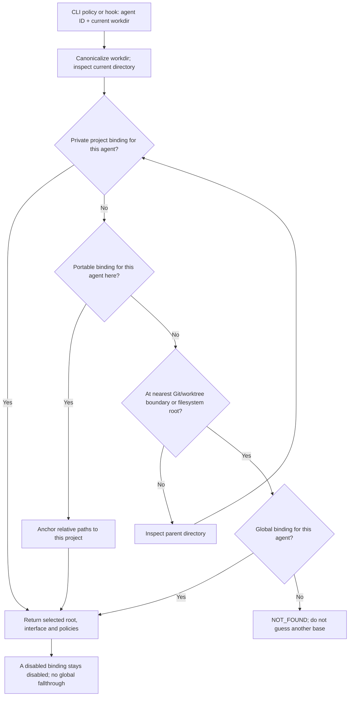

At each directory the private binding wins over the portable one. The nearest
applicable project binding wins over global; repository/worktree boundaries stop
the ancestor walk. A mismatching ambient `KB_ROOT` is diagnostic, not an override.
Ordinary data commands still use `--root`, then `KB_ROOT`, then ancestor
`.kb/config.toml`; they do not automatically call the setup resolver.

CLI rules therefore resolve first and pass `--root` explicitly. MCP model
consumers use the server's configured fixed root and inspect its responses;
they do **not** run the CLI resolver. Hooks in either mode resolve the native
event's `cwd`. After changing an MCP binding, reload/restart the native server:
an already running fixed-root process is not dynamically rerouted.

Portable setup is supported only for project CLI mode; commands use `kb` on
PATH. Portable global and portable MCP requests fail explicitly.

## How to read the harness diagrams

Each diagram shows the host loading its native configuration, the model's
selected CLI/MCP continuation, and any implemented automatic event path.
The two interface branches are **alternatives**, not simultaneous requirements.
Dotted event edges exist only when hooks are enabled and the host loads/trusts
them. `Core` is the same local KB read/write implementation, not a remote service.

In every host, the rule requires search **and supporting source reads**, honest
reporting of unavailable/degraded consultation, and preservation of the selected
root and interface. Rules apply to the actual harness ID, not its model name.

## Codex — `codex`

| Artifact | Project | Global |
| --- | --- | --- |
| Managed instruction block | `PROJECT/AGENTS.md`, or existing nonempty `AGENTS.override.md` | `HOME/.codex/AGENTS.md`, or existing nonempty `AGENTS.override.md` |
| CLI skill | `PROJECT/.agents/skills/knowledge-base/` | `HOME/.agents/skills/knowledge-base/` |
| MCP table | `PROJECT/.codex/config.toml` | `HOME/.codex/config.toml` |
| Hook entries | `PROJECT/.codex/hooks.json` | `HOME/.codex/hooks.json` |

MCP owns `[mcp_servers.knowledge-base]`. Hooks register **`SessionStart`** and
**`UserPromptSubmit`**, each calling `kb setup hook --agent codex --event EVENT`.
The handler returns `hookSpecificOutput` with the event name and
`additionalContext`. `CODEX_HOME` relocates global instructions/config/hooks;
the global shared skill still lives under `HOME/.agents/skills`.

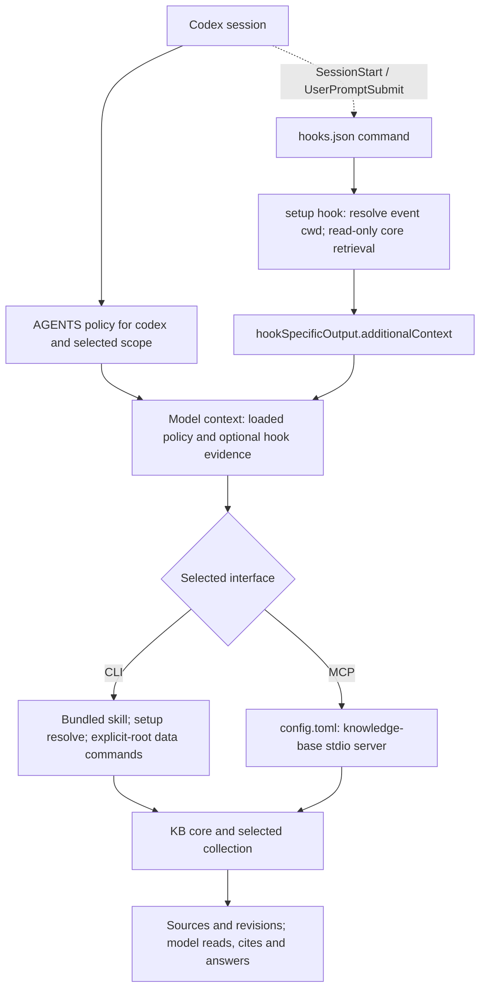

Native hook review/trust and restart remain necessary. Multiple native hook
layers may run; KB promises neither exactly-once delivery nor universal Codex
hook activation. The recorded Codex model retrieval qualification used CLI with
hooks off; configuring these hooks is a separate implemented capability.

## Claude Code — `claude`

| Artifact | Project | Global |
| --- | --- | --- |
| Rule file | `PROJECT/.claude/rules/knowledge-base.md` | `HOME/.claude/rules/knowledge-base.md` |
| CLI skill | `PROJECT/.claude/skills/knowledge-base/` | `HOME/.claude/skills/knowledge-base/` |
| MCP entry | `PROJECT/.mcp.json` | `HOME/.claude.json` |
| Hook entries | `PROJECT/.claude/settings.json` | `HOME/.claude/settings.json` |

MCP owns `mcpServers.knowledge-base`; hooks register `SessionStart` and
`UserPromptSubmit`. `CLAUDE_CONFIG_DIR` relocates the global rule, skill and
settings directory; when set, the global MCP file is its `.claude.json` child.

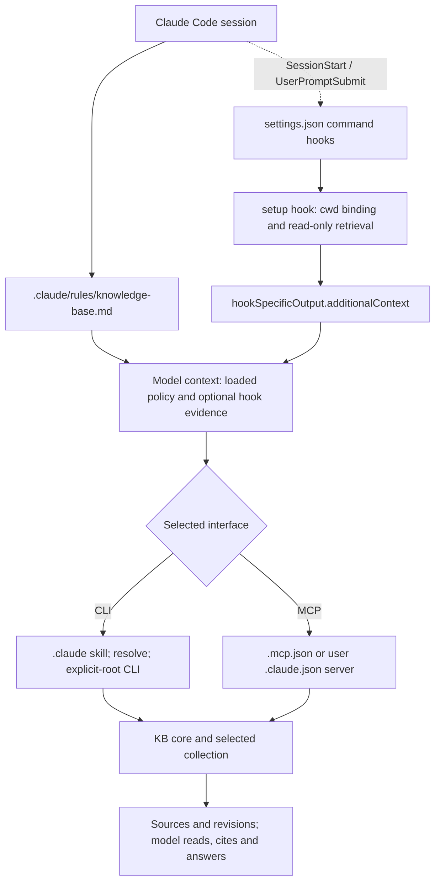

Host settings can disable hooks or restrict their sources. Setup does not change
those controls. Recorded Claude hook commands succeeded, but its model reply
was login-blocked; this is not evidence of complete Claude model retrieval.

## Pi — `pi`

| Artifact | Project | Global |
| --- | --- | --- |
| Managed instruction block | `PROJECT/AGENTS.md`, with existing fallback precedence below | `HOME/.pi/agent/AGENTS.md`, with the same precedence |
| CLI skill | `PROJECT/.pi/skills/knowledge-base/` | `HOME/.pi/agent/skills/knowledge-base/` |
| MCP entry | `PROJECT/.pi/mcp.json` | `HOME/.pi/agent/mcp.json` |
| Native extension | `PROJECT/.pi/extensions/knowledge-base.ts` | `HOME/.pi/agent/extensions/knowledge-base.ts` |

`PI_CODING_AGENT_DIR` relocates the global agent directory. For instructions,
the adapter chooses an existing nonempty `AGENTS.override.md`, `AGENTS.md`,
`AGENTS.MD`, `CLAUDE.md`, or `CLAUDE.MD`, in that order; otherwise `AGENTS.md`.
MCP owns `mcpServers.knowledge-base` in the host's native MCP file.

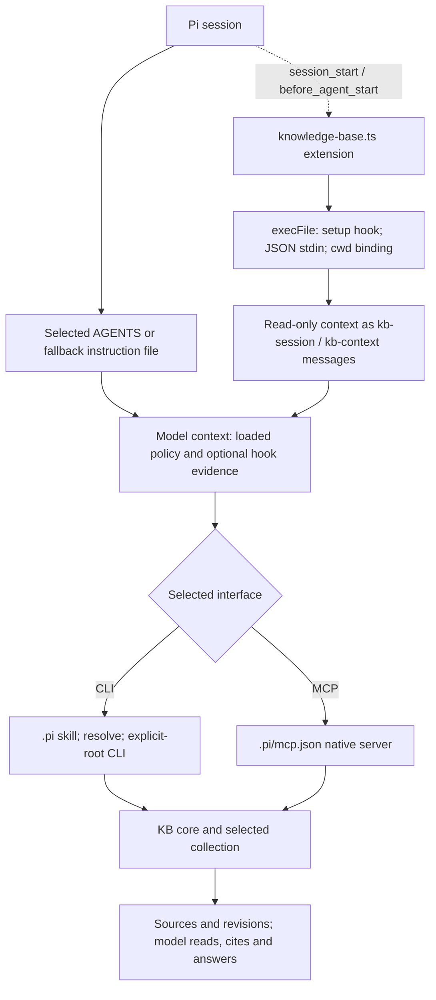

This is a host-loaded TypeScript extension using built-in child-process APIs;
setup does not install an npm package. Native project trust and reload are still
required. Pi custom-message turns are excluded from prompt retrieval. Native MCP
capability depends on the Pi build; configuration rendering does not qualify
older builds or replacement MCP extensions.

## Oh My Pi — `omp`

| Artifact | Project | Global default profile |
| --- | --- | --- |
| Managed instruction block | `PROJECT/.omp/RULES.md` | `HOME/.omp/agent/RULES.md` |
| CLI skill | `PROJECT/.omp/skills/knowledge-base/` | `HOME/.omp/agent/skills/knowledge-base/` |
| MCP entry | `PROJECT/.omp/mcp.json` | `HOME/.omp/agent/mcp.json` |
| Native extension | `PROJECT/.omp/extensions/knowledge-base.ts` | `HOME/.omp/agent/extensions/knowledge-base.ts` |

Project resources use `.omp`, not `.pi`. For global resources, `OMP_PROFILE`
precedes `PI_PROFILE`; an explicitly empty `OMP_PROFILE` selects default.
Named profiles use `HOME/<PI_CONFIG_DIR>/profiles/<name>/agent` and ignore
`PI_CODING_AGENT_DIR`. Default profile uses that override when supplied, otherwise
`HOME/<PI_CONFIG_DIR>/agent`; `PI_CONFIG_DIR` defaults to `.omp` and must be a
single directory name. XDG data/cache paths do not redirect these resources.

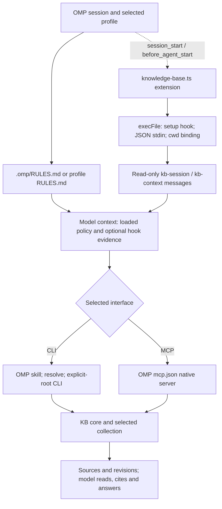

The wrapper skips revival events and custom-message turns. In observed OMP
18.16.0 sessions, same-name project extension precedence selected one prompt
context when both scopes were installed. That observation is not a portable
exactly-once guarantee. Real compaction, changed-root resume after process/server
restart, and both mixed CLI/MCP scope directions are recorded in
[native lifecycle evidence](evidence/setup-native-lifecycle.json).

## OpenCode — `opencode`

| Artifact | Project | Global |
| --- | --- | --- |
| Managed instruction block | `PROJECT/AGENTS.md`, or existing nonempty `CLAUDE.md` fallback | `CONFIG/opencode/AGENTS.md`, or enabled existing `HOME/.claude/CLAUDE.md` fallback |
| CLI skill | `PROJECT/.opencode/skills/knowledge-base/` | `CONFIG/opencode/skills/knowledge-base/` |
| MCP entry | `PROJECT/opencode.jsonc` if present, otherwise `opencode.json` | `CONFIG/opencode/opencode.jsonc` if present, otherwise `opencode.json` |
| Hook/plugin | **None installed** | **None installed** |

The local server entry is `mcp.knowledge-base`, with `type: local`, an executable
plus arguments in a `command` array, and `enabled: true`. Existing JSONC stays
JSONC. Custom `OPENCODE_CONFIG`, `OPENCODE_CONFIG_DIR`, or inline
`OPENCODE_CONFIG_CONTENT` layers are rejected; setup does not guess an effective
layer. Claude global fallback is used only when the relevant disable flags are
unset or empty and a native instruction file was not selected.

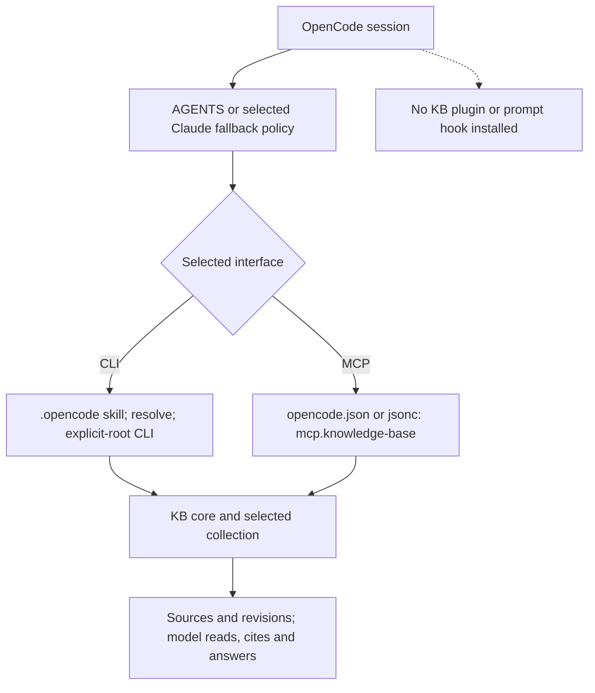

Automatic context injection is not implemented here. `hooks=auto` reports the
baseline fallback; `hooks=required` fails. Current V2 plugin APIs are not assumed
compatible with the configuration contract rendered by this adapter.

## Cursor — `cursor`

| Artifact | Project | Global |
| --- | --- | --- |
| Rule file | `PROJECT/.cursor/rules/knowledge-base.mdc`, `alwaysApply: true` | **Setup rejected**: User Rules are UI-managed |
| CLI skill | `PROJECT/.cursor/skills/knowledge-base/` | No automatic global installation |
| MCP entry | `PROJECT/.cursor/mcp.json` | No automatic global installation |
| Hook | **None installed** | **None installed** |

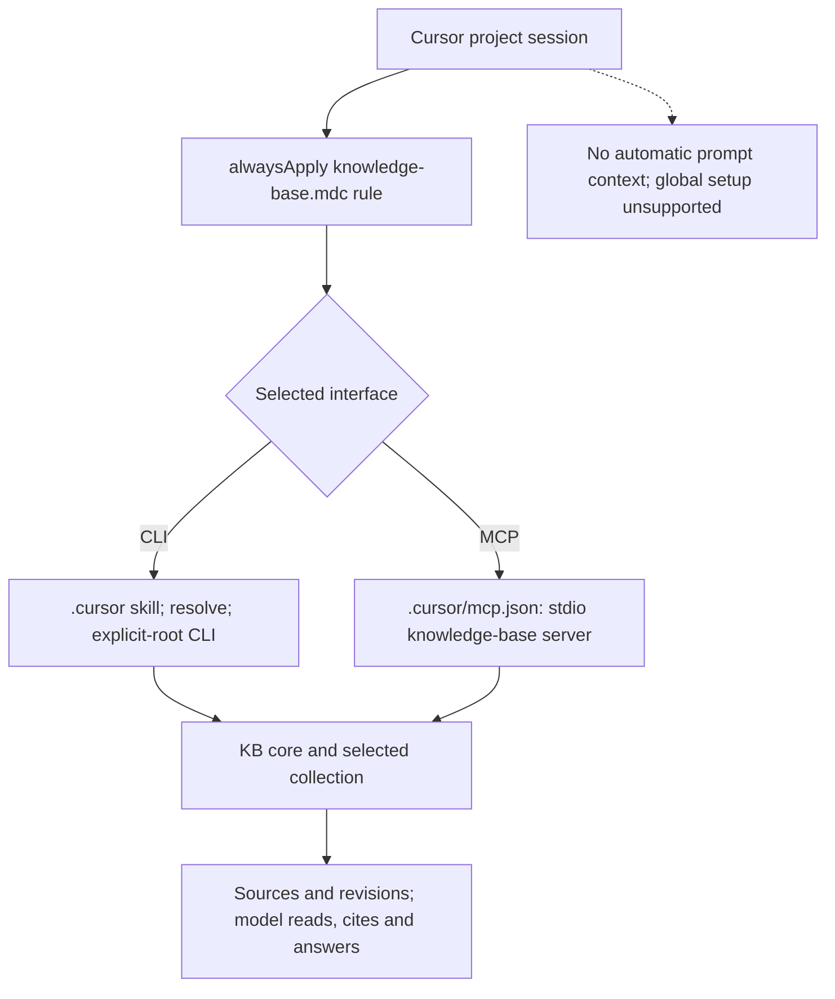

MCP owns `mcpServers.knowledge-base` and declares `type: stdio`. An always-apply
rule is a model instruction, not a retrieval event. Setup never promotes a
rejected global request into a project installation.

## Gemini CLI — `gemini`

| Artifact | Project | Global default home |
| --- | --- | --- |
| Managed instruction block | `PROJECT/GEMINI.md` | `HOME/.gemini/GEMINI.md` |
| CLI skill | `PROJECT/.agents/skills/knowledge-base/` | `HOME/.agents/skills/knowledge-base/` |
| MCP entry and hook entries | `PROJECT/.gemini/settings.json` | `HOME/.gemini/settings.json` |

With `GEMINI_CLI_HOME`, the global configuration root is
`<GEMINI_CLI_HOME>/.gemini`; global rules/settings and the CLI
`skills/knowledge-base` directory are kept there. Project paths stay local.

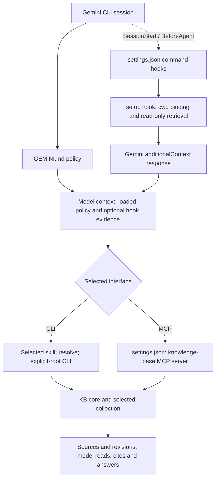

The prompt event is **`BeforeAgent`**, not `UserPromptSubmit`. Command-hook
timeout is expressed as **5,000 milliseconds** in Gemini settings. Native skill
consent and trusted-folder policies remain in force.

## GitHub Copilot / VS Code — `copilot`

| Artifact | Project | Global |
| --- | --- | --- |
| Managed instruction block | `PROJECT/.github/copilot-instructions.md` | `HOME/.copilot/copilot-instructions.md` |
| CLI skill | `PROJECT/.github/skills/knowledge-base/` | `HOME/.copilot/skills/knowledge-base/` |
| MCP entry | `PROJECT/.mcp.json` | `HOME/.copilot/mcp-config.json` |
| Hook | **None installed** | **None installed** |

`COPILOT_HOME` relocates the global directory. The adapter targets the shared
Copilot harness, not the older Local harness or a model merely named Codex/Claude.
MCP owns `mcpServers.knowledge-base`.

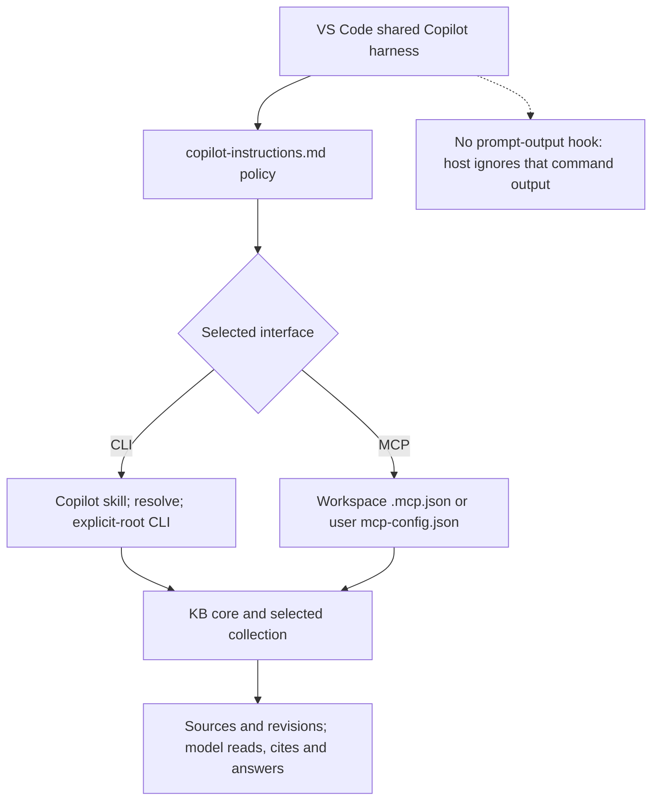

Workspace-root `.mcp.json` requires
`chat.mcp.workspaceRootConfig.enabled`; setup reports this prerequisite without
changing editor settings. The current harness ignores `userPromptSubmitted`
command output, so registering it would not provide the required context path.

## Antigravity — `antigravity`

| Artifact | Project | Global |
| --- | --- | --- |
| Rule file | `PROJECT/.agents/rules/knowledge-base.md` | `HOME/.gemini/config/rules/knowledge-base.md` |
| CLI skill | `PROJECT/.agents/skills/knowledge-base/` | `HOME/.gemini/config/skills/knowledge-base/` |
| MCP entry | `PROJECT/.agents/mcp_config.json` | `HOME/.gemini/config/mcp_config.json` |
| Hook | **None installed** | **None installed** |

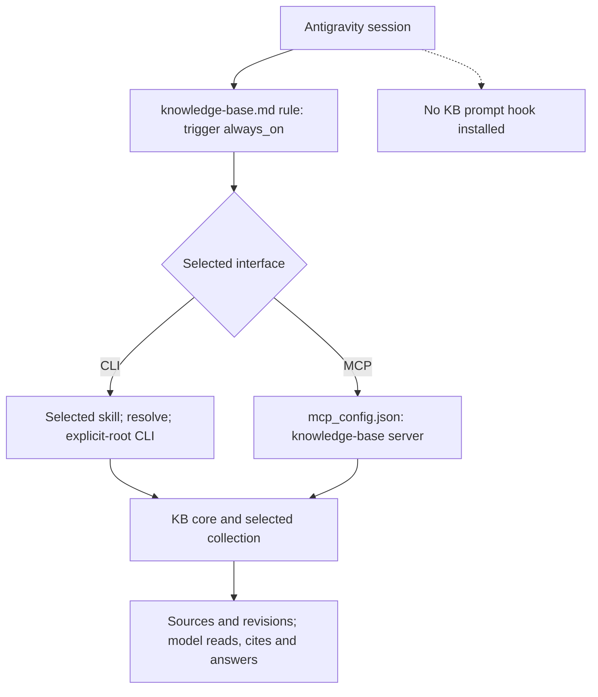

MCP owns `mcpServers.knowledge-base`. Setup uses current `.agents` project and
`.gemini/config` global paths; it does not migrate legacy `.agent` directories
or Gemini CLI configuration. `always_on` is rule metadata, not hook activation.

## Devin CLI — `devin`

| Artifact | Project | Global |
| --- | --- | --- |
| Managed instruction block | `PROJECT/AGENTS.md` | `CONFIG/devin/AGENTS.md` |
| CLI skill | `PROJECT/.agents/skills/knowledge-base/` | `CONFIG/devin/skills/knowledge-base/` |
| MCP entry | `PROJECT/.devin/mcp_config.json` | `CONFIG/devin/mcp_config.json` |
| Hook | **None installed** | **None installed** |

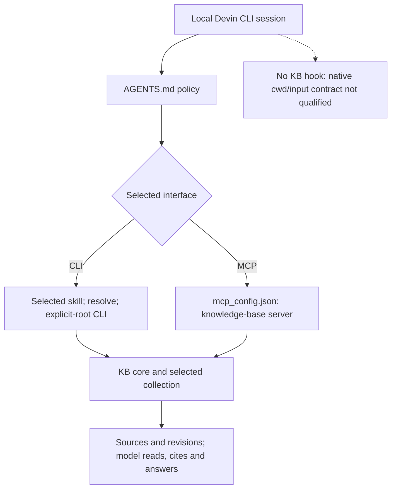

This is local Devin CLI, not Devin Cloud. Dedicated MCP configuration files
require v3000.3 or newer according to the adapter's recorded contract. Native
hooks exist upstream, but KB does not install one without the required cwd/input
contract. It does not expose a local base to a remote Devin environment.

## What a hook actually does

For Claude, Codex and Gemini, the host executes the configured command and sends
its native JSON on stdin. Pi/OMP load the generated extension, which uses
`execFile` with argv and JSON stdin, without a shell. Both routes reach
`setupHook`, `Engine.Resolve`, then `HookContextMode`.

1. Validate the native event, cwd and bounded JSON input (64 KiB).
2. Resolve this harness's effective binding using the event's cwd.
3. For session start, inspect status and return a root/policy reminder; no task
   query is searched. For a prompt, perform bounded lexical context retrieval.
4. Return source paths, revisions, lines and excerpts as untrusted evidence.
   Continue through the selected interface; MCP hooks do not require the model
   to invoke a CLI skill or shell. Focused source reads still follow.
5. Report no-hit, unavailable or disabled states honestly. Never write notes,
   append a conversation log, retry indefinitely, or approve native trust.

The dispatcher supplies a **1.5-second** cooperative deadline; the core helper
also caps its caller at two seconds, so the earlier deadline wins in this path.
Pi/OMP enforce a 3.5-second immediate-child process timeout using `SIGKILL`;
command-hook registrations use five seconds (5,000 ms for Gemini). Encoded
responses are capped at 16 KiB; excerpts at 1,200 estimated tokens / 4,800 bytes,
with at most five sources. These are bounds, not hard real-time guarantees or
general descendant-process supervision. See [failure qualification](setup-hook-qualification.md).

Hooks retrieve even when the continuation is MCP: they call the same core
directly, not the MCP server. The **model's** subsequent consultation uses only
its selected interface. A shell-free MCP consumer does not mean that the host's
optional hook machinery never launches the KB executable.

## Check, activation and uninstall

`setup check` compares owned artifacts and validates local prerequisites: selected
collection, executable availability, and current profile/instruction paths.
`configured` and local `ready` are not observed activation. The command leaves
`activation_observed=false` and explicitly reports unobserved native
version/platform compatibility, trust and session activation. A fresh native
source read is a separate check; setup does not launch a model to manufacture it.

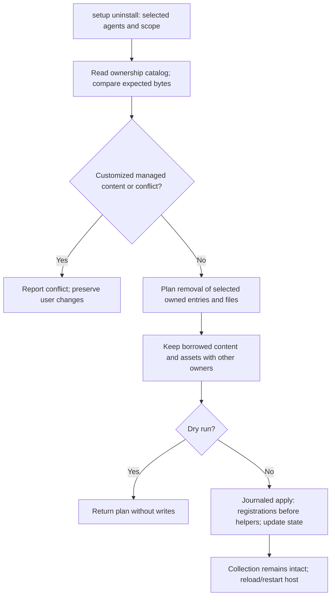

Uninstall never deletes the Knowledge Base. It removes exact owned regions,
preserves foreign content, and restores original bytes when the file remained
pristine. Interrupted publication uses `setup recover`; it does not require
deleting the state directory. Already loaded native processes may still need a
reload/restart after removal.

## Map this document to the code

| Code | Responsibility described above |
| --- | --- |
| [CLI setup](../internal/cli/setup.go) | Commands, choices/inheritance, `renderInstall`, embedded skill copy, collection validation/creation, preview/apply and `setupHook` dispatch |
| [Host adapters](../internal/agentsetup/adapter.go) | Descriptor capabilities, `Render` paths, profile precedence, `policy`, `mcpArgs` / `mcpEntry`, `hookArtifacts` |
| [Native extension](../internal/agentsetup/extension.go) | Pi/OMP event handlers, argv/stdin transport, process limits and custom-message delivery |
| [Hook protocol/core retrieval](../internal/agentsetup/hook.go) | `HookEvent`, `HookResponse`, `HookContextMode`, lexical bounds and native response formats |
| [Resolver and inspection](../internal/setup/resolve.go) | Project/portable/global precedence, disabled bindings and artifact checks |
| [Local readiness](../internal/cli/setup_readiness.go) | Local prerequisites; explicit boundary between ready and observed native activation |
| [Planning](../internal/setup/plan.go) and [artifacts](../internal/setup/artifacts.go) | Ownership, shared/borrowed assets, conflict detection and preservation |
| [Transactions](../internal/setup/transaction.go) | Locking, expected hashes, journal, publication and recovery |
| [Privacy](../internal/setup/privacy.go) and [portable bindings](../internal/setup/portable.go) | Personal activation exclusions and explicit relative project CLI bindings |
| [Bundled skill](../skills/knowledge-base/SKILL.md) | Model-driven CLI search/read/learning workflows; not an automatic hook |

The [compatibility matrix](setup-compatibility.md) carries primary host sources
and limitations. [Engine design](setup-design.md) gives transaction details.
[Review evidence](evidence/setup-review.json), [hook evidence](evidence/setup-hook-qualification.json)
and [native lifecycle evidence](evidence/setup-native-lifecycle.json) distinguish
configuration/source tests from actual named-host observations.
